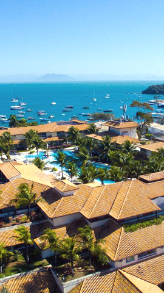
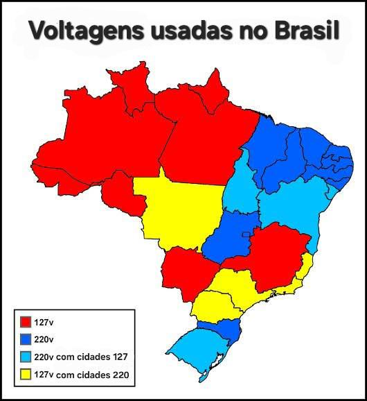
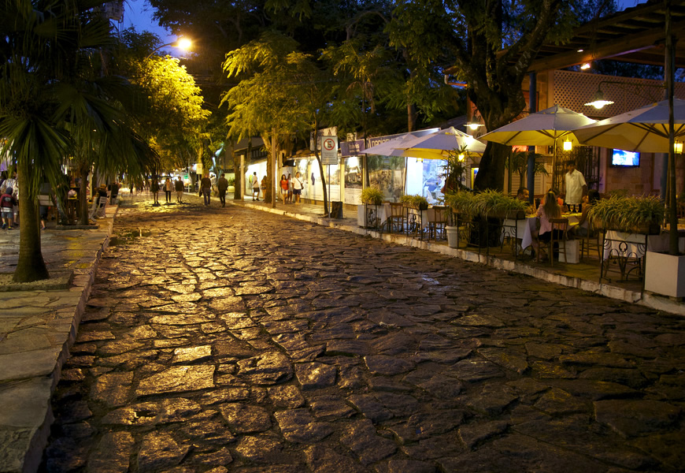
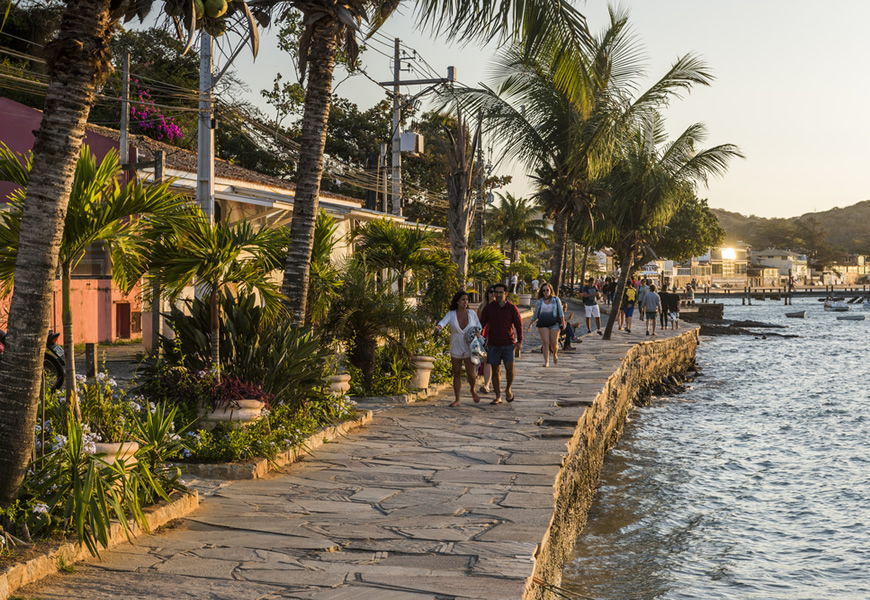

# 2026-11 Búzios Meeting Information {-}

::: { style="display:flex; flex-direction: row; justify-content: left;" }

:::: {#left style="display:flex; flex-direction: column; width: 50%; justify-content: left; padding: 10px;" }

You are thereby invited to the autumn 2026 meeting of WG21\
on **November 16-21, 2026, Monday to Saturday**, to be held online via Zoom and face-to-face in:

::::: { style="display:flex; flex-direction: row; justify-content: left;" }

:::::: { style="background-color: white; width: 96px; padding: 10px;" }
{ width=100% }
::::::

:::::: { style="background-color: white; padding: 10px;" }
[Hotel Atlantico Búzios](https://www.atlanticobuzios.com.br)\
[Estrada da Usina, 294 - Morro do Humaitá](https://maps.app.goo.gl/YnFb1TijgkTADTbaA)\
Armação de Búzios - Rio de Janeiro - Brasil\
::::::

:::::

The hotel is both the in-person meeting location and the recommended lodging.\
Internet access is included in your hotel room rate and provided in meeting spaces.\

## Registration {-}

Please [register](http://foo) your participation (in-person or virtual) with ISO.\
Your information is needed for in-person attendees’ name tags and catering.\

## Remote participation {-}

Zoom participation information and updates will be provided before the meeting via the [“meeting” email list](mailto:meeting@lists.isocpp.org) and on the Buzios 2026 meeting wiki.\

## Face-to-face participation {-}

Register until October 1, 2026. After that date, rooms are not guaranteed to be available.\
Use the "WG21" code when registering, either by [phone](tel:+55 22 2620-8850), or [whatsapp](https://wa.me/5522998264043), or [email](mailto:reservas@atlanticobuzios.com.br), or [online](https://ws3.pcsystems.com.br/reservas/?OP=BD&EO=18&LC=en-US).\

### Travel and transportation {-}

Buzios is served by the [Galeao International Airport (GIG)](https://www.riogaleao.com).\
Transportation shuttles will be provided to the guests free of change.\
Please [register](http://foo) when you are arriving, when you are leaving, how many persons, and the amount of luggage.\

### Meals and refreshments {-}

Coffee, tea and petit-fours will be provided at the meeting for mid-morning and mid-afternoon breaks.\
Attendees are responsible for their own meals. If you are staying at the venue hotel, breakfast will be included.\
There are many dining options available within walking distance, including the hotel restaurant.\

### Weather {-}

Búzios November weather is usually sunny, with occasional rain storms.\
Expect temperatures in the 20°C to 28°C range (68°F to 82°F).\
The venue is air-conditioned, including the meeting rooms.\
Light clothes are recommended, such as light sweaters.\

::::

:::: {#right style="display:flex; flex-direction: column; width: 50%; justify-content: left; padding: 10px;" }

### Welcome orientation {-}

First time attendees are welcome to an informal orientation on Sunday November 15 at 6pm, starting in the venue lobby and then taking a tour through the meeting areas.\
This will cover information about the wiki and email lists, how subgroups work, and any questions you might have.\

### Currency {-}

The Brazilian Currency is the Real.\
There are money exchange services available in the airport, and in Búzios.\
Mastercard and VISA credit cards are usually accepted in all establishments.\

### Visa {-}

All nationalities except USA, Canada and Australia can enter Brazil without a Visa.\
For citizens of those countries, [an e-visa can be procured online](https://brazil.vfsevisa.com),
or can be obtained in person through a brazilian embassy, valid for stays up to 90 days.\
Visa fees are set at reciprocal rates, and are currently at US$ 80.90, subject to change.

### Power and Electrical Plugs {-}

Unlike most countries, Brazil doesn't have standardized voltage on power sockets.\
Most cities in Rio, including the capital and Búzios, use 127V @ 60 Hz.
Some states in Brazil use 220V @ 60Hz, so if you are planning to visit
places far away from the capital and Búzios, please consult the map below.\
Power receptacles are compatible with the Europlug.\

{ width=80% }

### Language {-}

The language spoken in Brazil is Portuguese. You can expect most service providers
in Búzios to be able to communicate in basic english.\
Outside of those areas, you can't count on it, except on tourist oriented services.\
Camera-based instant translators, such as Google Translate, can also be used
to good effect.\

::::

:::

---

### Safety {-}

You can expect Búzios to be pretty safe, even to european standards. There is a small risk of petty theft.\
Some beaches can be hazardous if you are not an experienced swimmer.\
Beaches on the north and east side, which are facing the coast, are much calmer
than the beaches on the west and south side which face the open ocean.\
You can expect flags indicating beach hazards and life saver stations and
patrols.

Outside of Búzios, the situation is too complicated to explain briefly.\
In general, it is best to avoid using jewelry and other expensive items,
such as high-end electronics.\
Don't get distracted and stay a long time looking at your phone.\
When using public transportation, watch your pockets and bags when standing,
keep your bags and backpacks secured and closed, close the window if sitting next to one.\
When walking on the streets, theft attempts will usually be in the form of a bike or motorcycle assisted grab-and-run.\
Unless it looks obviously safe, walk far away from the road and bike lanes, and don't get distracted.\
In public transport, thefts will usually start with some attempt at distraction or misdirection.\
It will usually be something that happens and gets everyone looking at it, so protect your pockets when that happens.\
Criminals usually don't operate on their own; they have lookouts and their own security hiding in plain sight,
so you risk getting outnumbered if you react aggressively.\
Don't go into favelas on your own. Don't blindly follow GPS. Don't walk alone in dark and deserted areas.\

### Tourism {-}

::::: { style="display:flex; flex-direction: row; justify-content: left;" }

:::::: { style="background-color: white; width: 192px; padding: 10px;" }
{ width=100% }
::::::

:::::: { style="background-color: white; padding: 10px;" }
#### Rua das pedras (Cobble street) {-}
::::::

:::::

::::: { style="display:flex; flex-direction: row; justify-content: left;" }

:::::: { style="background-color: white; width: 192px; padding: 10px;" }
{ width=100% }
::::::

:::::: { style="background-color: white; padding: 10px;" }
#### Orla bardot (Bardot waterfront) {-}
::::::

:::::

### Organization and Sponsorship {-}

::::: { style="display:flex; flex-direction: row; justify-content: left;" }

:::::: { style="background-color: white; width: 192px; padding: 10px;" }
{ width=100% }
::::::

:::::: { style="background-color: white; width: 384px; padding: 10px;" }
{ width=100% }
::::::

:::::: { style="background-color: white; padding: 10px;" }

The meeting is sponsored and organized by the [C++ Alliance](https://cppalliance.org),
on behalf of the [Brazilian national standards body (ABNT)](https://abnt.org.br).

::::::

:::::