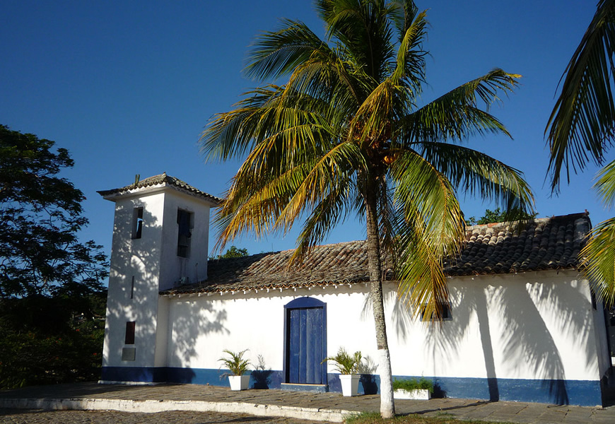
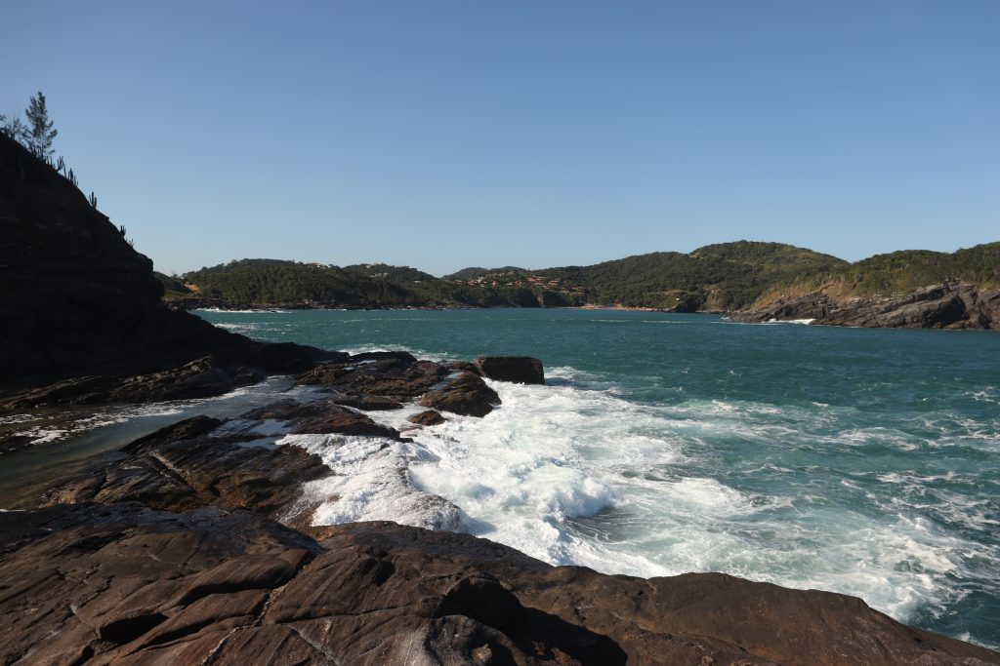
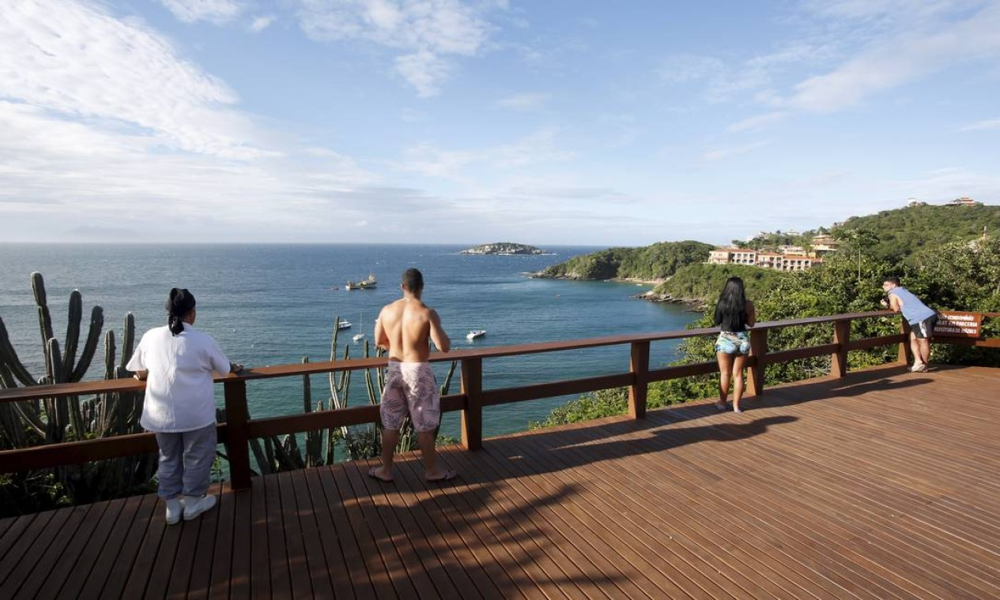
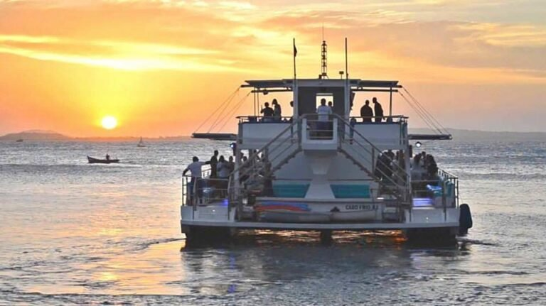
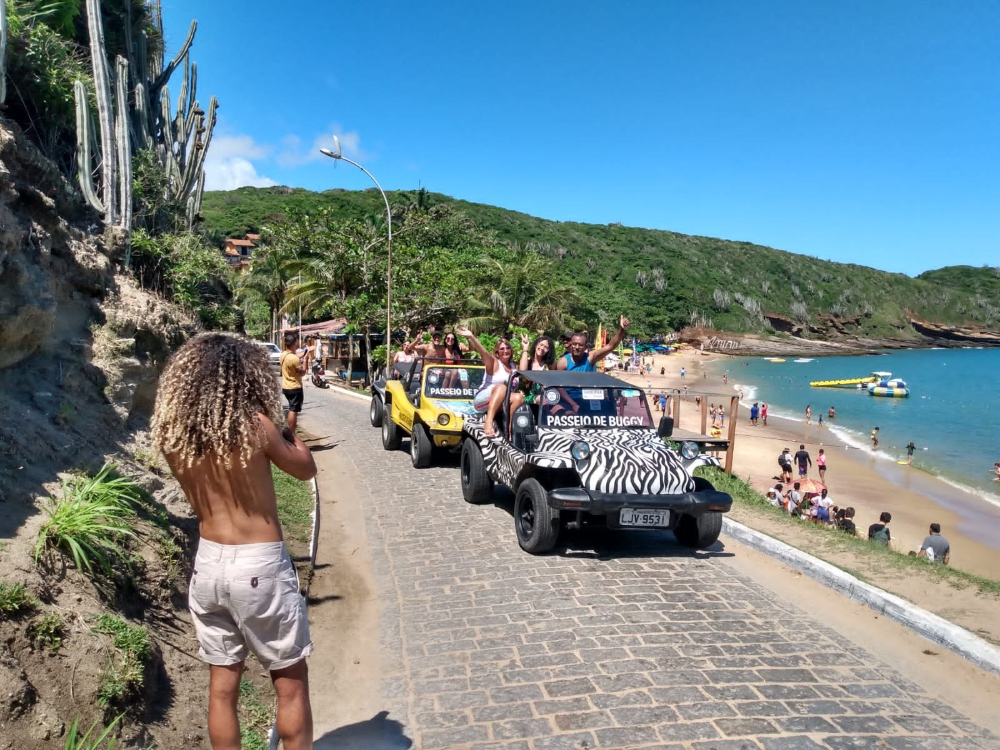

# 2026-11 Búzios Meeting Information {-}

::: { style="display:flex; flex-direction: row; justify-content: left;" }

:::: {#left style="display:flex; flex-direction: column; width: 50%; justify-content: left; padding: 10px;" }

You are thereby invited to the autumn 2026 meeting of WG21\
on **November 16-21, 2026, Monday to Saturday** (with orientation meeting for new members and guests on **November 15, 2026**),
to be held online via Zoom and face-to-face in:

::::: { style="display:flex; flex-direction: row; justify-content: left;" }

:::::: { style="background-color: white; width: 96px; padding: 10px;" }
{ width=100% }
::::::

:::::: { style="background-color: white; padding: 10px;" }
[Hotel Atlantico Búzios](https://www.atlanticobuzios.com.br)\
[Estrada da Usina, 294 - Morro do Humaitá](https://maps.app.goo.gl/YnFb1TijgkTADTbaA)\
Armação de Búzios - Rio de Janeiro - Brasil\
::::::

:::::

The hotel is both the in-person meeting location and the recommended lodging.\
Internet access is included in your hotel room rate and provided in meeting spaces.\

## Hotel reservation {-}

Register with the hotel until October 1, 2026. After that date, rooms are not guaranteed to be available.\
Use the "WG21" code when registering, either by [phone](tel:+55 22 2620-8850), or [whatsapp](https://wa.me/5522998264043), or [email](mailto:reservas@atlanticobuzios.com.br), or [online](https://ws3.pcsystems.com.br/reservas/?OP=BD&EO=18&LC=en-US).\

## ISO Meetings registration {-}

Please [register](https://sd.iso.org/meetings/174161) your participation with ISO, in the ISO meetings platform\
This is needed for name tags, transport, and catering.\

## Remote participation {-}

Zoom participation information and updates will be provided before the meeting via the [“meeting” email list](mailto:meeting@lists.isocpp.org) and on the Búzios 2026 meeting wiki.\

### Travel and transportation {-}

Buzios is served by the [Galeao International Airport (GIG)](https://www.riogaleao.com).\
The distance between hotel and airport is about a 3 hour drive.\
Transportation shuttles will be provided to the guests free of charge.\
A form will be made available in a later date, where it will be possible to register when you
are arriving, when you are leaving, how many persons, and the amount of luggage.\

### Meals and refreshments {-}

Coffee, tea and petit-fours will be provided at the meeting for mid-morning and mid-afternoon breaks.\
If you are staying at the venue hotel, breakfast will be included.\
There are many restaurants within walking distance, including inside the hotel.\

### Weather {-}

Búzios November weather is usually sunny, with occasional rain storms.\
Expect temperatures in the 20°C to 28°C range (68°F to 82°F).\
The venue is air-conditioned, including the meeting rooms.\
Light clothes are recommended, such as light sweaters.\

::::

:::: {#right style="display:flex; flex-direction: column; width: 50%; justify-content: left; padding: 10px;" }

### Welcome orientation {-}

First time attendees are welcome to an informal orientation on **Sunday November 15 at 6pm**, starting in the venue lobby and then taking a tour through the meeting areas.\
This will cover information about the wiki and email lists, how subgroups work, and any questions you might have.\

### Currency {-}

The Brazilian Currency is the [Real (BRL)](https://www.bcb.gov.br/en/currencyconversion).\
There are money exchange services available in the airport, and in Búzios.\
Mastercard and VISA credit cards are usually accepted in all establishments.\

### Visa {-}

Most nationalities can enter Brazil without a Visa.\
You can check [here](https://www.gov.br/mre/pt-br/embaixada-liubliana/servicos-consulares-1/vistos-vizumi-visas-1/visto-de-visita-vivis)
if a Visa is required for your country.\
For citizens of the USA, Canada and Australia, [an e-visa can be procured online](https://www.gov.br/mre/pt-br/consulado-miami/information-about-visas-in-english/electronic-visitor-visa-e-visa),
or can be obtained in person through a brazilian embassy, valid for stays up to 90 days.\
Visa fees are set at reciprocal rates, and are currently at US$ 80.90, subject to change.\

### Power and Electrical Plugs {-}

Unlike most countries, Brazil doesn't have standardized voltage on power sockets.\
Most cities in Rio, including the capital and Búzios, use 127V @ 60 Hz.
Some states in Brazil use 220V @ 60Hz, so if you are planning to visit
places far away from the capital and Búzios, please consult this [table](https://www.inf.ufrgs.br/~cabral/Tensao.nominal.estados.Brasil.html).\
Power receptacles are compatible with the Europlug.\

### Language {-}

The language spoken in Brazil is Portuguese. You can expect most service providers
in Búzios to be able to communicate in basic english.\
Outside of those areas, you can't count on it, except on tourist oriented services.\
Camera-based instant translators, such as Google Translate, can also be used
to good effect.\

### Safety {-}

You can expect Búzios to be pretty safe, even to european standards. There is a small risk of petty theft.\
Some beaches can be hazardous if you are not an experienced swimmer.\
Beaches on the north and east side, which are facing the coast, are much calmer
than the beaches on the west and south side which face the open ocean.\
You can expect flags indicating beach hazards and life saver stations and
patrols.

::::

:::

---

### Tourism {-}

::::: { style="display:flex; flex-direction: row; justify-content: left;" }

:::::: { style="background-color: white; width: 192px; padding: 10px;" }
{ width=100% }
::::::

:::::: { style="background-color: white; padding: 10px;" }
#### [Rua das Pedras (Cobble Street)](https://maps.app.goo.gl/XPfmihZCdVYuBAR3A) {-}

This is a pedestrian-only cobblestone street, where most of the bars, restaurants, coffee shops, stores, and art galleries are located.\
::::::

:::::

::::: { style="display:flex; flex-direction: row; justify-content: left;" }

:::::: { style="background-color: white; width: 192px; padding: 10px;" }
{ width=100% }
::::::

:::::: { style="background-color: white; padding: 10px;" }
#### [Orla bardot (Bardot Waterfront)](https://maps.app.goo.gl/PHCmVohWr7nRjcbb6) {-}

This is a big sidewalk with a nice view, which connects the end of the Cobble Street with the fisherman's wharf.\
It is named after and has a statue of french actress Brigitte Bardot.\
::::::

:::::

::::: { style="display:flex; flex-direction: row; justify-content: left;" }

:::::: { style="background-color: white; width: 192px; padding: 10px;" }
{ width=100% }
::::::

:::::: { style="background-color: white; padding: 10px;" }
#### [Igreja de Sant'Anna (Sant'Anna Church)](https://maps.app.goo.gl/2YnQH5CVxqv2coKK6) {-}

It's an old catholic church, built in the 18th century, which was built high up in a lookout point, offering nice views.\
::::::

:::::

::::: { style="display:flex; flex-direction: row; justify-content: left;" }

:::::: { style="background-color: white; width: 192px; padding: 10px;" }
{ width=100% }
::::::

:::::: { style="background-color: white; padding: 10px;" }
#### [Ponta da Lagoinha (Little Lake Point)](https://maps.app.goo.gl/M9PEqWtVLSbHc26r5) {-}

Ancient geological formation (~600M - 1B y/o), has interesting rock formations and natural pools.\
::::::

:::::

::::: { style="display:flex; flex-direction: row; justify-content: left;" }

:::::: { style="background-color: white; width: 192px; padding: 10px;" }
{ width=100% }
::::::

:::::: { style="background-color: white; padding: 10px;" }
#### [Mirante da Azeda (Azeda Beach Lookout)](https://maps.app.goo.gl/Mkj1SP2D4otMiKVe9) {-}

Lookout point located in a natural reserve, offers a nice view of the coast.
::::::

:::::

::::: { style="display:flex; flex-direction: row; justify-content: left;" }

::::: { style="display:flex; flex-direction: column; justify-content: left;" }

:::::: { style="background-color: white; width: 192px; padding: 10px;" }
{ width=100% }
::::::

:::::: { style="background-color: white; width: 192px; padding: 10px;" }
{ width=100% }
::::::

:::::

:::::: { style="background-color: white; padding: 10px;" }
#### [Water and other Activities](https://praiasdebuzios.com.br) {-}

There are many water rides available on the island, including schooner, catamaran, speedboat.\
Both for sightseeing tours, and also for transport.\
Dune buggy tours are also available, and also possible to rent (requires driving license).\
Other activities include diving, golf, kite surf, and wind surf.

::::::

:::::

### Organization and Sponsorship {-}

::::: { style="display:flex; flex-direction: row; justify-content: left;" }

:::::: { style="background-color: white; width: 192px; padding: 10px;" }
{ width=100% }
::::::

:::::: { style="background-color: white; width: 384px; padding: 10px;" }
{ width=100% }
::::::

:::::: { style="background-color: white; padding: 10px;" }

The meeting is sponsored and organized by the [C++ Alliance](https://cppalliance.org),
on behalf of the [Brazilian national standards body (ABNT)](https://abnt.org.br).

::::::

:::::